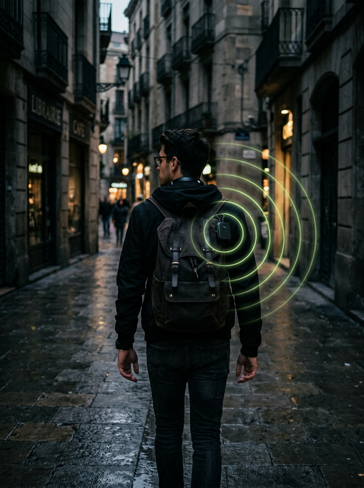
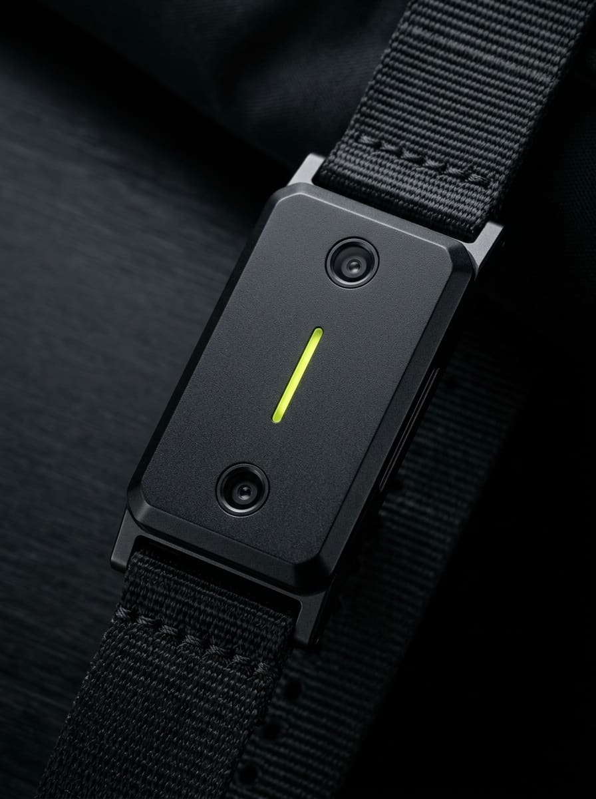
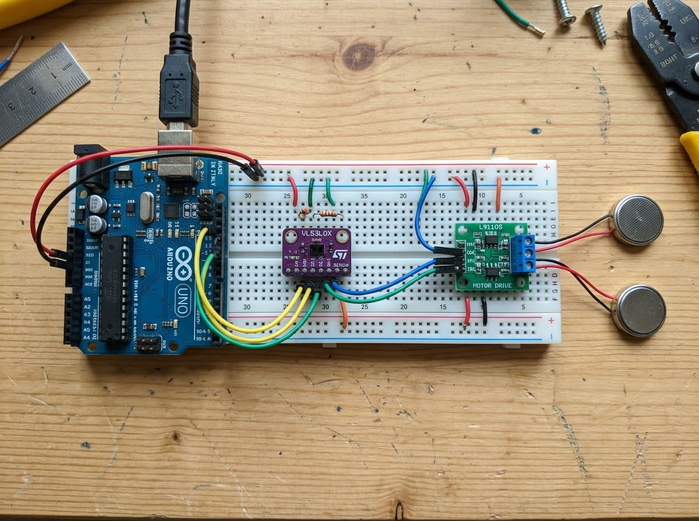
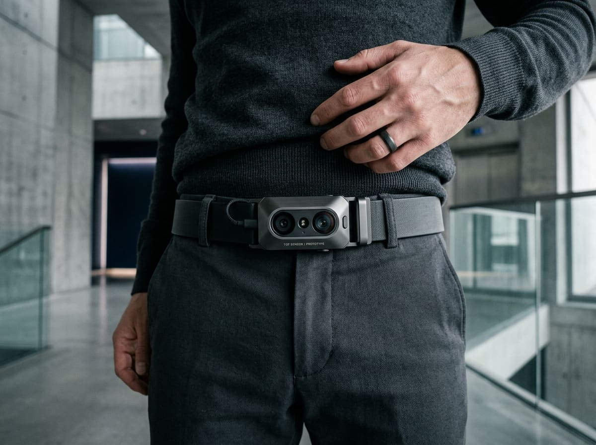
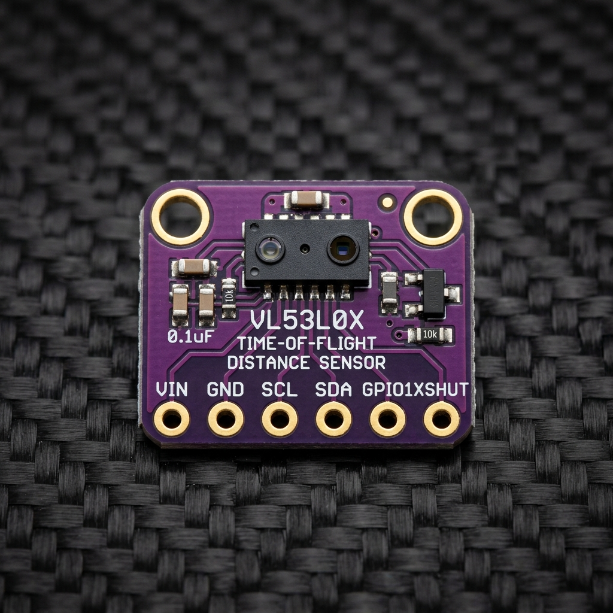
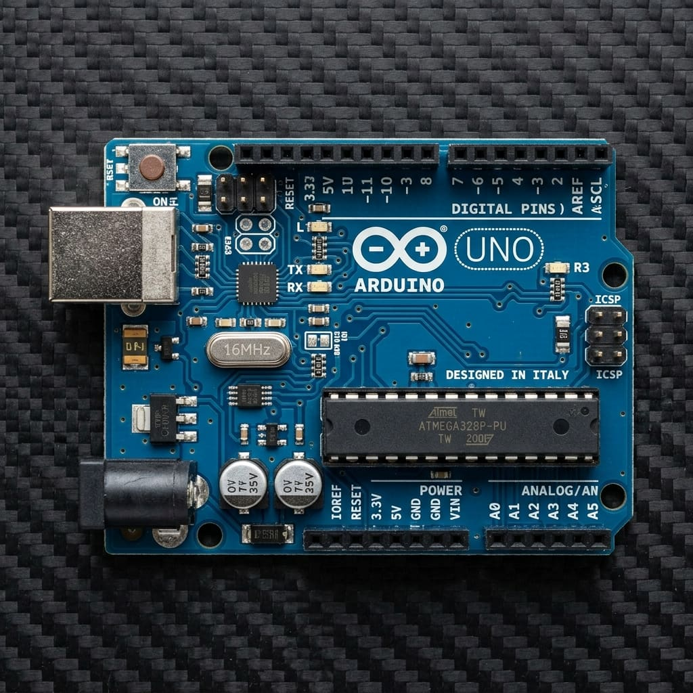
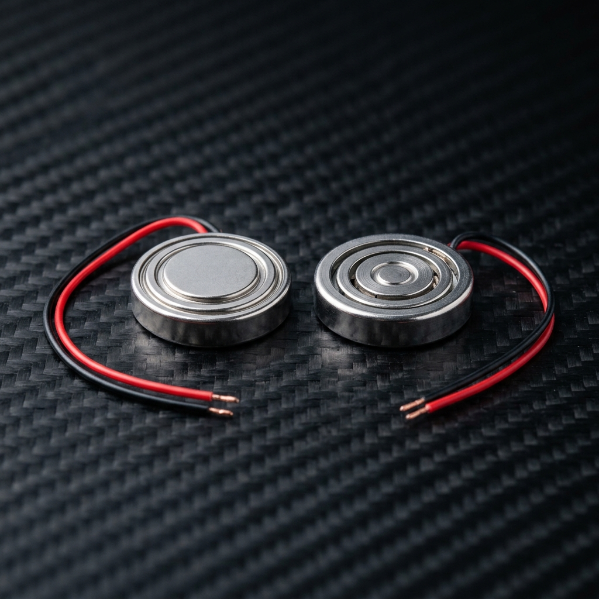
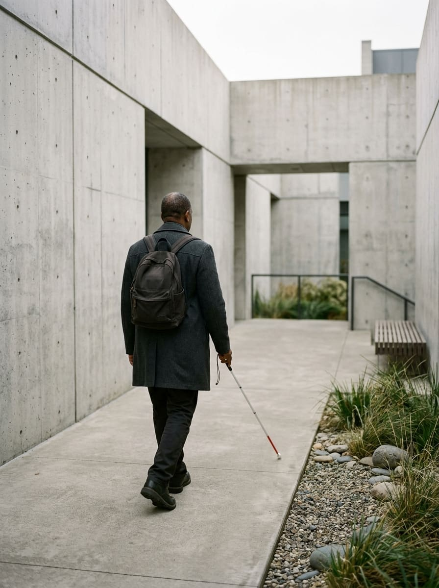

<div align="center">



# ◎ AURA GUIDE

### Spatial Awareness Attachment for the Visually Impaired

[](LICENSE)
[](https://react.dev/)
[](https://tailwindcss.com/)
[](https://greensock.com/scrolltrigger/)
[](https://www.st.com/en/imaging-and-photonics-solutions/vl53l0x.html)
[](https://www.w3.org/TR/WCAG22/)

> **_Feel the Space. Navigate with Confidence._**
>
> An offline-first, haptic wearable engineered to bridge the mobility blindspot for visually impaired individuals through millimeter-precision Time-of-Flight laser telemetry.

[🌐 Live Demo](http://localhost:5173/) • [🎛️ Guardian Dashboard](http://localhost:5173/dashboard) • [🔩 Hardware Specs](#-hardware-architecture--specifications) • [📊 Research](#-exploratory-research--problem-statement)

</div>

---

## 📌 Executive Summary

Standard white canes provide invaluable ground-plane tactile feedback — detecting drop-offs, curbs, and floor obstacles. However, they possess a critical physical blindspot: **they cannot detect mid-level, chest-height, and head-level hazards** such as protruding air conditioning units, overhanging branches, open truck liftgates, and elevated signage.

**AURA GUIDE** is an ergonomic, clip-on spatial awareness attachment designed to complement traditional mobility aids without replacing them. By pairing a 940nm Time-of-Flight (ToF) laser ranging sensor with an instantaneous, deterministic edge-computing feedback loop, AURA GUIDE converts distance into progressive, intuitive bilateral tactile vibrations — no internet connection required.

---

## 🖼️ Hardware Gallery

<table>
  <tr>
    <td align="center" width="33%">
      
      <br/><sub><b>🔩 Wearable Belt Module — Mk1 Prototype</b></sub>
    </td>
    <td align="center" width="33%">
      
      <br/><sub><b>🛠️ Benchtop Breadboard Circuit Assembly</b></sub>
    </td>
    <td align="center" width="33%">
      
      <br/><sub><b>🎽 Wearable Attachment — Ergonomic Fit</b></sub>
    </td>
  </tr>
  <tr>
    <td align="center" width="33%">
      
      <br/><sub><b>🔭 STMicro VL53L0X 940nm ToF Sensor</b></sub>
    </td>
    <td align="center" width="33%">
      
      <br/><sub><b>⚙️ Arduino UNO R3 — Edge Controller</b></sub>
    </td>
    <td align="center" width="33%">
      
      <br/><sub><b>📳 Dual ERM Coin Haptic Actuators</b></sub>
    </td>
  </tr>
</table>

---

## 🔬 Exploratory Research & Problem Statement



Initial exploratory user research (_n = 10_, SRM IST) revealed recurring friction points in independent urban navigation for visually impaired individuals:

| Finding | Statistic | Implication |
| :--- | :---: | :--- |
| Indoor disorientation in unfamiliar spaces | **60%** | Devices need to work offline in complex multi-floor environments |
| Chest- & head-height obstacle collisions | **50%** | Mid-level sensing is the primary unaddressed gap |
| Preference for tactile-only (non-auditory) feedback | **70%** | Vibration preserves acoustic echolocation; audio cues must remain optional |
| Demand for 100% offline, fail-safe operation | **80%** | Cloud dependency is a non-starter for life-safety applications |
| Value placed on real-time AI object recognition | **90%** | Roadmap target for Phase 5+ firmware |

> ⚠️ **Assistive Disclaimer:** AURA GUIDE is engineered as a **secondary, complementary spatial aid**. It does not replace the white cane, guide dog, or formal Orientation & Mobility (O&M) training.

<br clear="right"/>

---

## ⚡ Hardware Architecture & Specifications

```
 ┌───────────────────────────────────────────────────────────────┐
 │                    AURA GUIDE — SIGNAL PIPELINE               │
 └───────────────────────────────────────────────────────────────┘

       [ 940nm VCSEL Photon Burst · ~25° Field of View ]
                          │
                          ▼
          ┌───────────────────────────┐
          │      VL53L0X ToF Sensor   │  ←── 0.05m – 2.0m Range
          │   Measures photon return  │       Millimetric Precision
          │   time (direct VCSEL)     │       Immune to ambient light
          └──────────────┬────────────┘
                         │ I2C Fast Mode (400 kHz)
                         ▼
          ┌───────────────────────────┐
          │   ATmega328P @ 16 MHz     │  ←── Zero cloud dependency
          │   Deterministic Edge Loop │       < 15ms closed-loop latency
          │   3 Threshold Zones       │       Fail-safe on power loss
          └──────┬─────────┬──────────┘
                 │ PWM     │ PWM
     ┌───────────▼──┐  ┌───▼──────────────┐
     │ LEFT ERM     │  │ RIGHT ERM         │  ←── Synchronized bilateral
     │ Coin Motor   │  │ Coin Motor        │       vibration feedback
     │ (NPN Driver) │  │ (NPN Driver)      │
     └──────────────┘  └───────────────────┘
```

### Component Specifications

| Component | Specification | Functional Role |
| :--- | :--- | :--- |
| **Primary Sensor** | STMicro VL53L0X ToF | 940nm VCSEL infrared ranging · 0.05m–2.0m · ~25° FoV · Surface-color agnostic |
| **Edge Compute** | Arduino UNO R3 (ATmega328P @ 16 MHz) | Real-time deterministic sampling, distance thresholding, PWM haptic curve generation |
| **Haptic Actuators** | Dual 1027 Coin ERM Motors | Bilateral tactile feedback synchronized with inverse-distance PWM amplitude |
| **Driver Circuit** | Dual NPN 2N2222 + 1N4001 Flyback Diodes | Inductive kickback protection on isolated GPIO logic |
| **Power Supply** | 5V regulated / 3.7V LiPo + boost | ~95mA idle · ~180mA peak dual vibration |
| **Edge Latency** | `< 15ms` closed-loop execution | Real-time response at 1.2–1.4 m/s walking velocity |

---

## 🎛️ Tactile Calibration & Distance Zones

```
[Wearer] ──0.00m──────────────0.30m─────────────0.80m────────────2.00m──▶
               │    HAZARD ZONE  │  APPROACHING   │    SAFE ZONE    │
               │  ████████████   │  ▓▓▓▓▓▓▓▓▓▓   │  ░░░░░░░░░░░░  │
               │  Fast 6Hz pulse │  Gentle 2.5Hz  │  Motors idle   │
               │  "STOP / PIVOT" │  "Slow down"   │  "Clear ahead" │
```

| Zone | Distance Range | Haptic State | Vibration Pattern | Intent |
| :--- | :--- | :--- | :--- | :--- |
| 🟢 **Safe** | > 0.80m | Idle (`0%` duty) | Silent | Clear forward trajectory |
| 🟡 **Approaching** | 0.30m – 0.80m | Moderate pulse | 120ms ON @ 2.5Hz | Non-urgent obstacle advisory |
| 🔴 **Hazard** | < 0.30m | Intense continuous | 80ms ON @ 6.0Hz | Immediate stop / re-route tactile command |

---

## 💻 Web Dashboard Architecture


This repository ships a complete AURA GUIDE digital ecosystem built on a modern React 18 + TypeScript + Vite stack:

**Public Product Showcase**
- Minimal DTC-inspired product design, floating technical callout badges, and responsive hardware gauges
- GSAP ScrollTrigger scroll-pinned **4-stage sensory pipeline** (Detect → Process → Feel → Confidence)
- Parallax hero with floating hardware animation and progressive reveal sections

**Guardian Dashboard (Demo Architecture)**
- Simulated real-time frontal proximity radar visualization
- Live alert stream with severity classification (Safe / Advisory / Hazard)
- Simulated battery telemetry, session timeline, and incident log
- Remote haptic parameter tuning interface (demo simulation mode)

**Accessibility Engineering (WCAG 2.2 AA)**
- ⌨️ Full keyboard accessibility with visible focus indicators
- 🌓 Light / Dark mode with `localStorage` persistence
- 🔆 High-contrast mode toggle for low-vision users
- 🚫 `prefers-reduced-motion` compliance disabling vestibular-unsafe animations
- 📣 ARIA live regions and semantic landmark markup

<br clear="right"/>

---

## 📁 Repository Structure

```
aura-guide/
├── public/assets/                      # Hardware photography (9 hi-res images)
│   ├── arduino-uno.jpg
│   ├── belt-hero.jpg
│   ├── cane-traveler.jpg
│   ├── hero-traveler-radar.jpg
│   ├── prototype-breadboard.jpg
│   ├── vibration-motors.jpg
│   ├── vision-horizon.jpg
│   ├── vl53l0x-sensor.jpg
│   └── wearable-module.jpg
│
├── src/
│   ├── components/
│   │   ├── device/                     # Hardware diagrams, distance gauges & motor visualizers
│   │   ├── home/                       # Showcase sections & GSAP scroll cinematic story
│   │   │   ├── CinematicScrollStory.tsx   ← GSAP ScrollTrigger pinned 4-stage pipeline
│   │   │   ├── MasterHero.tsx             ← Parallax hero with floating product card
│   │   │   ├── MasterChallenge.tsx
│   │   │   ├── MasterHowItWorks.tsx
│   │   │   ├── MasterIdea.tsx
│   │   │   ├── MasterPrototype.tsx
│   │   │   └── MasterVision.tsx
│   │   ├── layout/                     # Navbar (scroll-progress bar), Footer (3D globe)
│   │   └── ui/                         # Accessible badges, buttons, modals, bento cards
│   ├── context/                        # ThemeContext (light/dark/high-contrast)
│   ├── data/                           # Telemetry fixtures & simulation providers
│   ├── pages/
│   │   ├── dashboard/                  # Guardian telemetry dashboard
│   │   └── public/                     # Home, About, How It Works, Prototype, Roadmap, Team
│   └── App.tsx
│
├── README.md
├── tailwind.config.js                  # Custom design tokens, typography scale
├── vite.config.ts
└── package.json
```

---

## 🚀 Getting Started

### Prerequisites
- **Node.js** v18.0.0+
- **npm** v9.0.0+

### Installation & Development

```bash
# 1. Clone the repository
git clone https://github.com/deepakktechh/aura-guide.git
cd aura-guide

# 2. Install dependencies
npm install

# 3. Start the local development server (Hot Module Replacement)
npm run dev
```

| URL | Description |
| :--- | :--- |
| `http://localhost:5173/` | Public product showcase |
| `http://localhost:5173/dashboard` | Guardian Dashboard demo |
| `http://localhost:5173/prototype` | Hardware breakdown & specs |
| `http://localhost:5173/research` | Survey findings & data |

```bash
# TypeScript type-check (no emit)
npx tsc --noEmit

# Production build (optimized, tree-shaken)
npm run build

# Preview production build locally
npm run preview
```

---

## 🗺️ Project Roadmap

```
Phase 0  ████████████████████████ ✅  Breadboard prototype + React showcase
Phase 1  ████████████████████████ ✅  GSAP scroll story + Guardian Dashboard
Phase 2  ████████░░░░░░░░░░░░░░░░ 🔄  ESP32 BLE/Wi-Fi telemetry migration
Phase 3  ░░░░░░░░░░░░░░░░░░░░░░░░ 📐  CAD enclosure + magnetic belt clip
Phase 4  ░░░░░░░░░░░░░░░░░░░░░░░░ 🔐  E2E encrypted MQTT + mobile companion app
Phase 5  ░░░░░░░░░░░░░░░░░░░░░░░░ 🧠  Multi-sensor spatial array + edge AI object detection
```

- [x] **Phase 0:** Breadboard circuit (Arduino UNO + VL53L0X + Dual ERMs) + public web showcase
- [x] **Phase 1:** GSAP ScrollTrigger sensory pipeline + simulated Guardian Dashboard
- [ ] **Phase 2:** Hardware migration to **ESP32-WROOM-32** with BLE/Wi-Fi telemetry
- [ ] **Phase 3:** Custom CAD 3D-printed enclosure with magnetic quick-release belt clip
- [ ] **Phase 4:** End-to-end encrypted MQTT telemetry syncing to caregiver mobile app
- [ ] **Phase 5:** Multi-sensor spatial array + optional on-device edge-AI object classification

---

## 👥 Academic Context

| Field | Detail |
| :--- | :--- |
| **Project Title** | Spatial Awareness Attachment for the Visually Impaired |
| **Product Name** | AURA GUIDE |
| **Course** | Design Thinking and Methodology (DTM) |
| **Department** | CSE Core-N |
| **Institution** | SRM Institute of Science and Technology, Ramapuram, Chennai |
| **Tech Stack** | React 18 · TypeScript 5.5 · Tailwind CSS 3.4 · GSAP 3.15 · Vite 5.4 |
| **Hardware** | Arduino UNO R3 · VL53L0X ToF · Dual ERM Coin Motors |

---

## 📄 License

Released under the [MIT License](LICENSE).

---

<div align="center">


<br/>

**AURA GUIDE** — Crafted with human-centered empathy, assistive engineering, and open accessibility principles.

*SRM Institute of Science and Technology · Design Thinking and Methodology · 2026*

</div>
